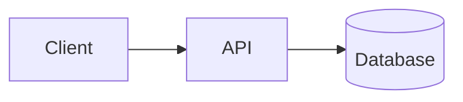

import { LinkCard } from '@astrojs/starlight/components';

Keep your architecture docs next to your `.c4` files. LikeC4 discovers Markdown in a `docs/` folder, embeds live diagrams by referencing a view's id, and links prose to views and other docs. One source of truth, versioned with your model.

The feature is opt-in and backward compatible: with no `docs/` folder, nothing changes. When docs are present, they are served by `likec4 build` and can be exported to [MkDocs / Backstage TechDocs](#mkdocs--backstage-techdocs) or a [portable Markdown bundle](#portable-markdown-bundle).

:::note
This is LikeC4's built-in docs renderer. For embedding diagrams into an existing MkDocs site with a third-party build plugin, see the community [MkDocs plugin](/tooling/community/mkdocs-plugin/) instead.
:::

## Folder layout

By default, docs live in a `docs/` folder next to the project's config file. `.md` files are discovered recursively:

```
my-project/
├─ likec4.config.json
├─ model.c4
└─ docs/
   ├─ index.md
   ├─ architecture.md
   ├─ nav.yaml            # optional
   └─ adr/
      ├─ 0001-use-event-bus.md
      └─ 0002-adopt-likec4.md
```

Each doc maps to a route derived from its path: `architecture.md` → `/docs/architecture`, `adr/0001-use-event-bus.md` → `/docs/adr/0001-use-event-bus`. An `index.md` takes its folder's route (`adr/index.md` → `/docs/adr`), and the root `docs/index.md` becomes the docs entry (`/docs`). Two files that resolve to the same route produce a build diagnostic (the first in sorted order is kept).

## Configure

The `docs` block is optional. Omit it and LikeC4 uses the defaults shown above.

```json
{
  "$schema": "https://likec4.dev/schemas/config.json",
  "name": "my-project",
  "docs": {
    "dir": "docs",
    "entry": "index",
    "landing": true
  }
}
```

| Option    | Type      | Default  | Description                                                                                                      |
| --------- | --------- | -------- | --------------------------------------------------------------------------------------------------------------- |
| `dir`     | `string`  | `"docs"` | Docs folder, relative to the config file folder.                                                                |
| `entry`   | `string`  | —        | Route path of the landing doc, relative to the docs folder, **without extension**. Defaults to the root `index.md` when present, otherwise the first top-level doc. |
| `landing` | `boolean` | `false`  | Make the docs entry the project's default landing page. Opt-in.                                                 |

:::note
All keys are optional. Omitting the `docs` block entirely keeps the existing behavior.
:::

## Navigation

The navigation tree is built one of two mutually exclusive ways: by convention, or from an explicit `docs/nav.yaml`. When `nav.yaml` is present it is used in full and the convention is ignored.

### Convention (default)

Without a `nav.yaml`, docs are ordered by convention:

- Docs with a numeric `order` come first, ascending; the rest follow alphabetically by label.
- A doc's label is its frontmatter `title`, else its first `#` heading, else a humanized filename.
- A folder's label and child order come from its optional `index.md` frontmatter (`title`, `order` number, or `order` as an array of child names); otherwise the folder name is humanized.

```markdown
---
title: Architecture overview
order: 1
---

# Architecture overview
```

### Explicit `nav.yaml`

Place a `docs/nav.yaml` to control the tree explicitly. It uses mkdocs-style entries: `Label: path.md`, a bare `path.md`, or a `Section Label:` with a nested list. Paths are relative to the docs folder and `.md` is optional.

```yaml
nav:
  - Overview: index.md
  - Architecture: architecture.md
  - ADRs:
      - adr/0001-use-event-bus.md
      - Adopt LikeC4: adr/0002-adopt-likec4.md
```

- The tree is built entirely from `nav.yaml`; convention ordering is ignored.
- Discovered `.md` files that are not listed are **hidden** from the tree, and the build emits a warning listing each hidden file.
- A listed entry's label is its explicit nav label when given, else the page title.
- A non-existent target produces a diagnostic (the entry is still kept). Malformed YAML or a missing `nav:` key is lenient: LikeC4 warns and falls back to the convention.
- The first nav doc becomes the default entry, unless `docs.entry` in the config overrides it.

## Embed a diagram

Reference a view by id in a ` ```likec4-view ` fenced block. The view renders live in the built site:

````markdown
# Billing

```likec4-view
view: billing-flow
focus: billing.processor
dynamic: sequence
theme: auto
padding: 24
```
````

The body is one `key: value` per line:

| Key       | Required | Value                                          |
| --------- | -------- | ---------------------------------------------- |
| `view`    | yes      | View id. Must appear exactly once.             |
| `focus`   | no       | Element FQN to focus within the view.          |
| `dynamic` | no       | `diagram` or `sequence` (for dynamic views).   |
| `theme`   | no       | `light`, `dark`, or `auto`.                    |
| `padding` | no       | Non-negative integer.                          |

An unknown key, a missing value, a missing `view`, or a duplicate `view` is an error, so typos surface.

:::note
Embeds reference a view by **id**, never a baked image, so diagrams stay in sync with the model. An invalid reference renders a non-fatal placeholder rather than failing the build. A bare ` ```likec4 ` fence is reserved for future inline DSL and currently renders as a plain highlighted code block.
:::

## Mermaid blocks

A ` ```mermaid ` fenced block renders client-side with light/dark theme support. The source is passed through unchanged; a parse error shows a non-fatal notice.

````markdown

````

:::note
PlantUML is out of scope for embedded docs. Use `likec4 gen plantuml` to generate `.puml` files from views instead — see [CLI](/tooling/cli/#generate-mermaid-dot-d2-plantuml).
:::

## Links

Two kinds of links are rewritten during the build.

**Diagram links** — `likec4://view/<id>` with optional `?focus=…` and `?dynamic=diagram|sequence` query params, rewritten to the in-app diagram route:

```markdown
[billing flow](likec4://view/billing-flow?focus=billing.processor)
```

**Inter-doc links** — relative `.md` links, resolved against the doc's folder to a `/docs/…` route:

```markdown
[architecture](architecture.md)
[ADR 1](adr/0001-use-event-bus.md)
[parent](../index.md)
```

A `#anchor` is preserved. An unknown view or a non-existent doc target produces a diagnostic and the link is left unchanged. External, absolute, and anchor-only links are untouched.

:::caution
Folder and file names with spaces are supported — a path round-trips through per-segment `%20` encoding, so `docs/my service/notes.md` resolves correctly.
:::

## ADR convention

LikeC4 has no scaffold command for Architecture Decision Records; the convention below is guidance. Keep ADRs in `docs/adr/` with numbered, kebab-cased filenames (`NNNN-kebab-title.md`) and frontmatter:

```markdown
---
title: Use an event bus
status: accepted
date: 2026-01-15
---

# Use an event bus

...decision body...
```

`status` and `date` are open frontmatter keys surfaced in the model. Link each ADR back to the views it affects with a ` ```likec4-view ` embed or a `likec4://view/<id>` link.

## Publish

### Static site

Docs are included in the output of `likec4 build` and served as part of the static website. For host-specific routing (hash history, base path) and deployment, see the existing guides:

<LinkCard
  title="Build a static website"
  description="Serve diagrams and docs as a static site"
  href="/guides/static-website/"
/>

<LinkCard
  title="Deploy to GitHub Pages"
  description="Host the generated site on GitHub Pages"
  href="/guides/deploy-github-pages/"
/>

### Images for external targets

Render every doc-referenced view to a content-hashed SVG plus an `images.json` manifest (view id → image path):

```sh
likec4 export image -p my-project -o ./docs/assets src/likec4
```

A `dynamic: sequence` reference renders the sequence variant. See [CLI — Export doc-referenced images](/tooling/cli/#export-doc-referenced-images).

### MkDocs / Backstage TechDocs

Export docs to a MkDocs / Backstage TechDocs tree — Markdown pages, images, and a generated `mkdocs.yml`:

```sh
likec4 export techdocs -p my-project -o ./techdocs --site-url https://c4.acme.dev src/likec4
```

This emits `docs/<route>.md`, images under `docs/images/`, and `mkdocs.yml` with `site_name` and `nav:`. A ` ```likec4-view ` embed becomes a static image plus a `View interactive version →` link to `<site-url>/view/<id>`; ` ```mermaid ` blocks pass through; `likec4://` and inter-doc links are rewritten. `--site-url` defaults to `/`.

:::note
`likec4 export techdocs` requires React and Playwright; you are prompted to install them if missing.
:::

### Portable Markdown bundle

Export a platform-neutral Markdown + images bundle for any external publisher (Confluence, a wiki, etc.):

```sh
likec4 export markdown-bundle -p my-project -o ./bundle --site-url https://c4.acme.dev src/likec4
```

This emits `<route>.md` pages, images under `images/`, and a `manifest.json` describing the doc tree, order, and entry. A ` ```likec4-view ` embed becomes a relative image reference (plus a `View interactive version →` link only when `--site-url` is given); ` ```mermaid ` blocks are left as fenced blocks for the downstream publisher. `--site-url` is optional.

:::caution
LikeC4 is platform-neutral and knows nothing about Confluence. Delivery (API, auth, page upsert) is done by a third-party publisher in your CI, with your CI secrets — LikeC4 holds no tokens.
:::

## See also

<LinkCard
  title="CLI — Export"
  description="All export subcommands and their options"
  href="/tooling/cli/#export-doc-referenced-images"
/>

<LinkCard
  title="Community MkDocs plugin"
  description="Third-party build plugin for embedding diagrams into MkDocs"
  href="/tooling/community/mkdocs-plugin/"
/>
