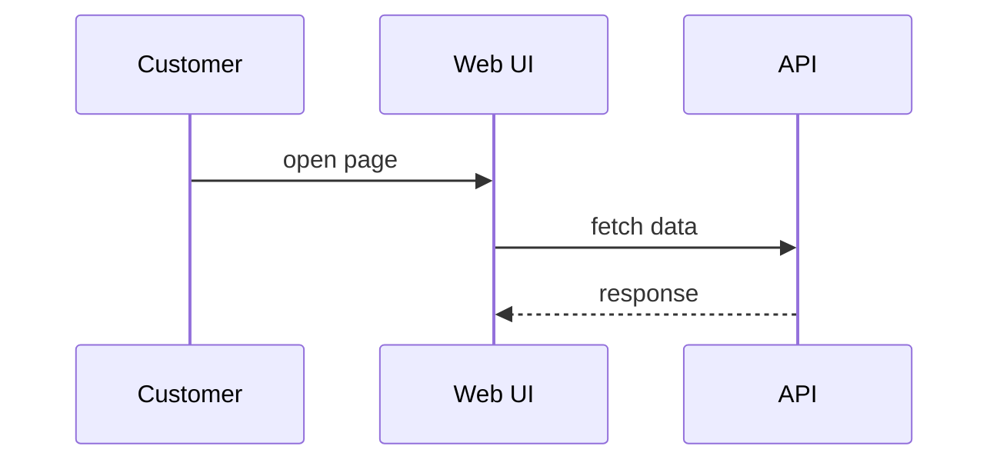

# Architecture

The shop is a single system composed of a web UI and an API. Customers use the
web UI, which calls the API.

## Components

- **Web UI** — the browser-facing frontend.
- **API** — the backend service.

## Landscape

The interactive landscape diagram, embedded straight from the model:

```likec4-view
view: index
```

## Shop, focused on the API

```likec4-view
view: shop
focus: shop.api
padding: 24
```

## A view that does not exist

This reference is invalid and must render a non-fatal notice without breaking
the rest of the page:

```likec4-view
view: does-not-exist
```

## Request flow (Mermaid)



## A broken Mermaid block

The diagram below has invalid syntax and must render a non-fatal notice:

```mermaid
this is not valid mermaid @@@
```
